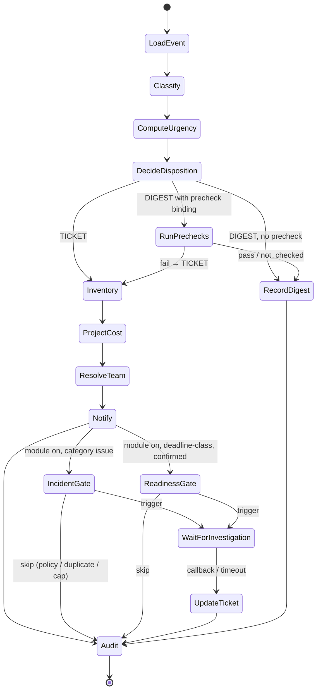

# AWS Health Event Triage Agent — Design (Master Spec)

> **Status:** v1 approved at the end of Ideation. Companion to `requirements.md` (intent) and
> `tasks.md` (capability checklist). This document describes the intended architecture; where the code and
> this document disagree after Build, the Build agent updates this document to match reality or
> fixes the code, and says which.

## 1. Design principles

1. **Deterministic by default, a language model only where judgement is needed.** Exactly one step
   uses Amazon Bedrock: classifying an event's description into a class, a reason, a deadline
   phrase, and verification steps. Every count, date calculation, cost figure, gate decision,
   routing decision, and de-duplication is pure code.
2. **One record per event ARN.** All state (consolidation, tickets, investigations, audit) is keyed
   by `eventArn`. Updates mutate that record and its ticket in place.
3. **Nothing is dropped.** Every event ends as a ticket or a digest line with an audit record; every
   failure lands in a dead-letter queue with a metric.
4. **Read-only against customer resources.** The agent inspects; humans (via pull requests) change.
5. **Configuration over code.** Suppression lists, prechecks bindings, routing, Agent Space registry,
   thresholds, and prompts are data.
6. **Optional modules are additive.** Disabling a module never changes the core path's output shape;
   fields become `unverifiable` or absent, never missing keys.

## 2. Pattern selection

| Concern | Pattern | Why |
|---|---|---|
| Classification step | **Strands Agents SDK on AWS Lambda** (pattern #6), invoked as a Step Functions task | One short, stateless invocation per event: one Amazon Bedrock call plus at most three side-effect-free tool calls, typically 10–60 s, worst case a few minutes with throttling retries; 10-minute Lambda timeout leaves 5× headroom. No session, no chat, no MCP, so AgentCore Runtime's session isolation and gateway add cost and a second runtime to operate without benefit. Revisit if an interactive triage assistant is added later. |
| Orchestration | **AWS Step Functions (Standard)** driving Lambda tasks | Durable waits for DevOps Agent callbacks, per-step retries, visible execution history per event |
| Deterministic steps | AWS Lambda (Python 3.12+) | Pure code, no state in memory |
| Investigation engine | **AWS DevOps Agent as headless investigation engine** (pattern #9c): event → Step Functions `waitForTaskToken` → DevOps Agent via signed webhook → callback | Reuses the AWS Health-triage reference orchestration; DevOps Agent does the topology work. **Widened 2026-09-28, working spec `feat-devops-agent-enrichment`, R8/R12 revision:** this row previously covered only the live-issue incident gate (optional). Deadline-class resource enrichment (R8.2) — previously a per-service Lambda plug-in per account — now uses the identical mechanism, and readiness (R12.3) is now the same investigation rather than a second one. See §3.4 for the redesign and §13 for why a custom agent was rejected for this role. |
| Readiness + remediation (optional) | Readiness folded into the enrichment investigation above (§13's decision record retains this row's PR-generation half unchanged) | Human-merged change, no runtime mutation |

DevOps Agent Skill alone (#9) and Custom SRE Agent (#9a) were ruled out for the core because they
cannot de-duplicate across the organization, produce digests, or keep ticket lifecycle
(`requirements.md` §3).

## 3. Architecture

```mermaid
flowchart LR
    subgraph HA["AWS Health admin account (management or delegated admin)"]
        R1["EventBridge rule<br/>source: aws.health<br/>(one per enabled Region, StackSet A)"]
    end
    subgraph AG["Agent account (central, one Region)"]
        BUS["Central event bus"]
        Q["SQS queue (KMS) + DLQ"]
        IN["Intake Lambda<br/>parse · idempotency · consolidate · enrich"]
        SQ["Settle queue (KMS) + DLQ<br/>(added 2026-09-28, task −1b)"]
        SC["Settle consumer Lambda<br/>(added 2026-09-28, task −1b)"]
        SFN["Step Functions: TriageWorkflow"]
        CL["Classify task: Strands on Lambda<br/>(Bedrock + Guardrails)"]
        UR["Urgency (precision)"]
        DI["Disposition rules"]
        PC["Prechecks (MSK, EKS Fargate)"]
        IV["Impact inventory<br/>(EKS, RDS, Lambda plug-ins)"]
        CO["Cost projection (precision)"]
        RT["Routing"]
        SK["Sinks: SNS core · Jira · chat"]
        GT["DevOps Agent gates (optional)"]
        CB["Callback Lambda"]
        DG["Digest Lambda (scheduled)"]
        RC["Reconcile Lambda (scheduled, optional)"]
        DB[("DynamoDB: events, idempotency,<br/>tickets, investigations, audit,<br/>config, routing, registry")]
    end
    subgraph OA["Agent Space owner account (co-located with the operations account by default)"]
        AS["DevOps Agent Agent Space"]
    end
    R1 -->|"cross-Region"| BUS --> Q --> IN --> SQ --> SC --> SFN
    IN <--> DB
    SFN --> CL --> UR --> DI --> PC --> IV --> CO --> RT --> SK
    SFN --> GT -->|"webhook"| AS
    AS --> BUS --> CB -->|"SendTaskSuccess"| SFN
    DG --> DB
    RC --> Q
    SK --> DB
```



**Diagram updated 2026-09-28, working spec `feat-devops-agent-enrichment` (Phase B, live-validated and
deleted this session).** The prior diagram's `MB["Member accounts (StackSet B)"]` /
`RO["HealthTriageReadOnlyRole"]` subgraph and its `sts:AssumeRole` edges from `IV`/`PC` are gone —
`HealthTriageReadOnlyRole` and StackSet B are deleted; the Inventory Lambda makes no AWS API call at
all (§3.4's redesign). The `OA["Agent Space owner accounts (StackSet C, optional)"]` subgraph and its
`FW["EventBridge forward rule"]` box are also gone — StackSet C is deleted; Agent Spaces are
co-located in the operations account by default, so `aws.aidevops` completion events reach the central
bus's own callback rule directly, with no forwarding hop (`AS --> BUS` replaces the old
`AS --> FW --> BUS` edge). A customer who keeps an Agent Space in a separate owner account re-adds
their own forwarding rule; the callback handler itself is unchanged either way (§6).

### 3.1 Ingestion (R1, R2, R3)

- **StackSet A** deploys, in every enabled Region of the Health admin account, one rule
  `{"source": ["aws.health"]}` targeting the central bus (cross-Region, cross-account target with a
  resource policy on the bus). Global events arrive via the US East (N. Virginia) rule.
- Central bus rule → **SQS** (server-side encryption with a customer-managed KMS key, 14-day
  retention, DLQ after 5 receives). SQS gives buffering, retries, and a DLQ that EventBridge alone
  would not.
- **Intake Lambda** (batch size 10, partial batch failure reporting):
  1. Validate the message against the AWS Health EventBridge schema; on failure → DLQ with reason.
  2. Idempotency: conditional `PutItem` on `Idempotency` with key
     `eventArn#affectedAccount#lastUpdatedTime#page` (TTL 30 days). Duplicate → ack and stop.
     **(Corrected 2026-09-28, working spec `feat-devops-agent-enrichment` §3.0, task −1a.** The key was
     previously `eventArn#lastUpdatedTime` — event granularity only. AWS Health's organizational-view
     feed sends one message per `(affectedAccount, page)` for a single update, all sharing `eventArn`
     and `lastUpdatedTime`; the old key made every message after the first for that update look like a
     duplicate of the first and drop it before step 3 ever ran, for both a second account and a second
     page of one account's entity list.)
  3. Consolidate: `UpdateItem` on `ConsolidatedEvents[eventArn]`: add `affectedAccount` to the account
     set, merge `affectedEntities` (keyed by entity value; keep latest status), record `page/totalPages`
     seen, set latest description, status, timestamps, category, scope, `actionability`, `personas`,
     and stamp `lastMessageAt` with the current time.
  4. Enrich: for new accounts, read `AccountContextCache` or call Organizations
     (`DescribeAccount`, `ListParents` up to root, `ListTagsForResource`), derive `Environment_Type`
     from configurable tag keys then OU name patterns, cache with TTL (default 24 h).
  5. Enqueue a settle-window message to a second SQS queue (`SettleQueue`, KMS-encrypted, own DLQ),
     `DelaySeconds = INTAKE_SETTLE_SECONDS` (default 60), carrying `{eventArn, lastUpdatedTime}`. The
     Intake Lambda itself never calls `StartExecution`.
     **(Added 2026-09-28, same working spec, task −1b.** Previously step 5 called `StartExecution`
     directly on every message, with execution name `sha256(eventArn + lastUpdatedTime)[:64]`. For a
     single-message event this was correct; for a multi-message fan-out it could start the workflow
     against a record that was still accumulating accounts from messages 2..N. The fixed execution
     name is unchanged — see the settle consumer below, which is now the only caller.)**
- **Settle consumer Lambda** (new, task −1b; batch size 10, partial batch failure reporting): drains
  `SettleQueue` after each message's delay has elapsed, by which point every message for that
  `(eventArn, lastUpdatedTime)` has had time to merge (a real AWS fan-out for one update completes in
  seconds; 60s default is comfortably past it — see R8's latency target). Starts `TriageWorkflow` with
  execution name `sha256(eventArn + lastUpdatedTime)[:64]` and the `eventArn` as input. This is the
  ONLY caller of `StartExecution`. N settle messages for one AWS update (one per intake message) all
  resolve to the same fixed execution name, so N−1 calls fail on `ExecutionAlreadyExists` and are
  caught and ignored — the pre-existing collapsing behaviour, now reached against a settled record.
  The workflow always reads the latest consolidated record, so late pages/accounts belonging to a
  *new* `lastUpdatedTime` are picked up by that update's own execution, exactly as before.
- **Reconcile Lambda** (optional, EventBridge Scheduler): from a stored `lastUpdatedTime` watermark
  call `DescribeEventsForOrganization`, then `DescribeEventDetailsForOrganization` (10 per call) and
  `DescribeAffectedAccountsForOrganization`, and enqueue messages in the same EventBridge shape so the
  Intake Lambda handles them identically.

### 3.2 Triage workflow (Step Functions Standard)



Task behaviour:

| State | Type | Behaviour |
|---|---|---|
| LoadEvent | Lambda | Read `ConsolidatedEvents[eventArn]`; if `statusCode = closed` and a ticket exists → close path (Notify with `closed`, Audit) |
| Classify | Lambda (Strands agent, 2 GB, 10-min timeout, ARM64) | Input: consolidated event, account contexts, per-code guidance. Output validated against `ClassificationResult` JSON schema; on schema failure retry once with the validation error appended, then `UNCLASSIFIED` with reason `schema_failure`. Bedrock throttling: exponential backoff, 3 attempts |
| ComputeUrgency | Lambda (precision) | From `deadline` and `now` with configured thresholds |
| DecideDisposition | Lambda (precision) | Class defaults + `DispositionOverrides[eventTypeCode]` + precheck binding lookup |
| RunPrechecks | Lambda (data retrieval + precision) | Assume member read role; run bound precheck; return `pass / fail / not_checked` |
| Inventory | Lambda | Affected entities + service plug-in lookups via member read role; `Impact_Status` |
| ProjectCost | Lambda (precision) | Only when class or event code implies cost; pricing from config or Price List API |
| ResolveTeam | Lambda (precision) | Routing table precedence |
| Notify | Lambda | Build versioned payload; `sns:Publish`; adapters create/update/close by `TicketMap[eventArn]` |
| IncidentGate / ReadinessGate | Lambda (precision + data retrieval) | Registry lookup, policy, cap counters, duplicate check, trigger; returns `triggered` with task token stored in `Investigations`, or `skipped` with reason |
| WaitForInvestigation | `waitForTaskToken` | Heartbeat 30 min, timeout configurable (default 4 h incident, 24 h readiness) → on timeout `impact: unverifiable (timeout)` |
| UpdateTicket | Lambda | Fold investigation outcome into payload and ticket |
| RecordDigest / Audit | Lambda | Write `AuditLog`, emit metrics |

Retries: every Lambda task uses exponential backoff (3 attempts) and a Catch to an `Audit` state that
records the failure and raises a metric, so an execution never ends without an audit record.

### 3.3 Classification agent (Strands on Lambda)

- **Runtime:** AWS Lambda container image (`python:3.12-slim`, non-root, ARM64), 2 GB memory,
  10-minute timeout, reserved concurrency sized to the Bedrock quota — implemented via the
  `lambdaReservedConcurrency` CDK context flag (default `5`, a conservative starting point; a real
  deployer raises it once they've confirmed their account's actual Bedrock on-demand RPM quota via
  Service Quotas). Expected duration 10–60 s; the legacy single-agent design that consolidated,
  inspected EKS, projected cost, and published in one invocation is gone, so nothing long-running
  remains in the agent.
- **Framework:** Strands Agents SDK, `BedrockModel` with `BEDROCK_MODEL_ID` (default from `tech.md`,
  cross-Region inference profile for the deployment Region) and `guardrail_id`/`guardrail_version`
  from configuration.
- **Prompt:** `src/prompts/classifier.md`, optionally overridden from S3 at start-up (source logged).
  Structure: role, the six classes with the R4.3 disambiguation rules, the deadline rule
  (earliest customer-impacting date, quote the phrase), instruction to call `normalize_dates` for
  any date and never compute urgency, instruction to treat the event text between delimiters as data,
  and the output schema.
- **Input contract:** `{event: ConsolidatedEvent, accounts: [AccountContext], guidance: EventTypeGuidance | null}`.
- **Output contract (`ClassificationResult`, JSON Schema in `src/schemas/`):**
  `classification` (enum), `reason` (string ≥ 1 sentence), `deadline` (ISO date or null),
  `deadline_basis` (quoted phrase or null), `verification_steps` (array of strings, may be empty),
  `notes_for_operator` (string or null). No counts, no urgency, no cost.
- **Tools available to the agent (see §5):** `get_event_type_guidance`, `get_affected_entities`,
  `normalize_dates`. Nothing that writes, nothing that calls another model.
- **Prompt-injection controls:** event text placed after explicit delimiters; schema validation on
  output; Guardrails on input and output; the agent has no tools capable of side effects.

> **Guardrail configuration:** the `AutonomousRemediation` denied topic runs on the `STANDARD` topic
> tier, not `CLASSIC` (the CDK default when `topicsTierConfig` is omitted). Live-measured evidence: on
> `CLASSIC`, ordinary AWS Health notification text that merely *describes* an action AWS itself will
> take — e.g. "this instance will be automatically upgraded... unless you upgrade manually beforehand"
> (RDS end-of-support) — false-positived as autonomous-remediation intent 40-100% of the time across
> four real event types (RDS end-of-support, EKS Fargate patching, ElastiCache update notices, AWS
> Config redaction notices), which is what caused the classifier's `UNCLASSIFIED`/`schema_failure`
> fallback under real traffic (Bedrock returns no JSON when a guardrail blocks the call). `STANDARD`
> resolved this to a near-zero false-positive rate on the same four cases while two real
> prompt-injection / remediation-bypass attempts still blocked 10/10 — the security boundary is
> unaffected, only its accuracy on benign text improved. `STANDARD` requires cross-Region guardrail
> inference (`crossRegionConfig` pointing at the deployment geography's system-defined profile, e.g.
> `eu.guardrail.v1:0` for EU); the classifier's `bedrock:ApplyGuardrail` IAM grant covers the
> guardrail's own ARN plus every one of that profile's destination-Region `guardrail-profile` ARNs
> (never a wildcard) — a deployment outside the profile's valid source Regions must swap the profile
> ID (and the matching destination-Region ARN list) or accept the documented `CLASSIC`-tier
> false-positive rate. Amazon Bedrock guardrail versions are immutable and content-addressed (there is
> no `UpdateGuardrailVersion` API), so `CfnGuardrailVersion`'s `description` is set to a content hash
> of the guardrail's own policy (content filters, topics, tier, PII entities, cross-Region profile ID,
> blocked-messaging strings) — CloudFormation then replaces the version resource whenever the real
> policy changes. `TriageWorkflowStack` resolves the guardrail version via an SSM dynamic reference
> against `GuardrailStack`'s `GuardrailVersionParam`, not a literal cross-stack prop, so
> `GuardrailStack` can always replace that resource on a future policy change without a cross-stack
> export lock.

### 3.4 Disposition, prechecks, inventory (R6, R7, R8)

- `DispositionOverrides` table: `eventTypeCode → {disposition: TICKET|DIGEST, precheck: name|null,
  note}`. Shipped seed marks maintenance-class and confirmation codes `DIGEST`; the `precheck` field is
  kept for schema compatibility (no migration needed) and re-read, per event type, as "this code's
  enrichment investigation may escalate on `at_risk` evidence" (R7, rewritten below) rather than "run
  this precheck function."
- **Redesigned 2026-09-28, working spec `feat-devops-agent-enrichment`, R7/R8.2 revision.** The
  per-service inventory plug-ins (`src/inventory/eks.py`, `rds.py`, `lambda_.py`, each an
  `sts:AssumeRole` into a member account followed by a service-specific `Describe*`/`List*` call) and
  the two prechecks (`src/prechecks/fargate_posture.py`, `msk_patch_safety.py`, which in the deployed
  system were always `not_checked` — their optional read paths, an EKS access entry and
  `kafka:DescribeClusterV2` + CloudWatch, were never provisioned) are **removed**, along with the
  precheck runner and `HealthTriageReadOnlyRole`. The Inventory Lambda now makes **no AWS API call at
  all**. Its new body:
  1. Read the event's own `affectedEntities` (with AWS-reported status) and the Environment_Type
     breakdown from account context — both already in code, no lookup needed.
  2. Look up the event type's **impact locus** (`get_impact_locus(eventTypeCode)`, a pure config read
     of `config/event-type-guidance.json`, default `listed_resource` when absent).
  3. IF the affected account is covered by a registered Agent Space (the same registry R12.6 already
     describes): hand off to the DevOps Agent gate (`ResolveAgentSpace` → `DecideInvestigation` →
     `TriggerInvestigation`, unchanged from R12's incident-gate mechanism, now also reached for
     deadline-class events) and STOP — the workflow proceeds to the enrichment investigation instead
     of a plug-in call.
  4. ELSE: return `Impact_Status` from step 1's entity list, qualified by step 2's locus, per R8.3's
     derivation order — `confirmed` / `in_scope_unverified` / `unverifiable`, with the specific reason
     named. No webhook is sent for an uncovered account.
  The investigation's `## Affected resources` table (six fixed columns: account, resource ARN,
  resource type, current version, status, evidence) is parsed by a new deterministic tool,
  `parse_affected_resources`, into the same `lookups: list[dict]` shape the three deleted plug-ins
  produced, so `build_impact_inventory` and `project_cost` (§3.4.1, unmodified) run unchanged on the
  parsed result. A malformed or missing table degrades to step 4's entity-list baseline with the
  defect named on the ticket — never a silent partial inventory, and never a downgrade of AWS's own
  entity evidence.
- The two prechecks' checks (single-replica Deployments, blocking PodDisruptionBudgets, standalone
  pods; MSK offline-partition history correlated with a replication-factor notice) are now **described
  in the DevOps Agent Incident RCA skill** as things the investigating agent checks or reports it
  cannot see, rather than implemented in code (R7). A `status: at_risk` row on a `DIGEST`-dispositioned
  maintenance-class event's parsed table escalates to `TICKET`, naming the resource — the same
  `escalate_on_precheck_failure` function R6.4 already used, now fed by the parsed table.
- Additional EventBridge rule (optional, unchanged): `{"source": ["aws.eks"], "detail-type": ["EKS
  Fargate Pod Scheduled Termination"]}` in member accounts forwarded to the central bus → treated as a
  synthetic `TICKET` event keyed by the pod's cluster/namespace/name.

#### 3.4.1 Cost projection: sources and method (R9)

The legacy estimator used a static USD-per-resource table; it is replaced by list prices from the
AWS Price List Query API plus resource facts from the inventory. The model never sees or produces a
number; it may only extract an announced price change from a notice as a structured field.

| Service | Model | Inputs from inventory | Price source (`get_pricing`) |
|---|---|---|---|
| Amazon EKS | per cluster-hour; extended rate replaces standard rate (increment = extended − standard) | clusters on the affected version | Price List `AmazonEKS` (SKU attribute confirmed in Build); fallback `config/pricing-overrides.json` |
| Amazon RDS / Aurora | per vCPU-hour by engine, Region, and year tier (years 1–2, year 3; Aurora MySQL flat at year-1); every instance incl. replicas and Multi-AZ standbys | instance class → vCPU (checked-in map, as in `aws-samples/rds-extended-support-cost-estimator`), Multi-AZ, replica count, engine, version | Price List `AmazonRDS` |
| Amazon OpenSearch Service | flat rate per Normalized Instance Hour | instance types and counts → NIH via config factors | Price List `AmazonES` + `config/nih-factors.json` |
| Amazon ElastiCache | percentage premium on node on-demand price | node type and count | Price List `AmazonElastiCache` × premium from config |
| Generic pricing-change notices | current usage × announced delta | usage baseline via Cost Explorer `GetCostAndUsage` (payer account, optional) | delta from the notice's structured extraction; `unknown` when absent |

Method: `project_cost(inventory, pricing, horizon)` returns per resource, per account, and
organization totals for: monthly increment (730 h), projection to the Deadline, and 12-month
projection; year tiers for RDS; increment and total fee for EKS; an `assumptions` list (24×7, no
upgrade, list price, no private pricing or discounts, USD) and `confidence: list_price |
usage_based | unknown`. `PricingCache` (TTL 7 days) fronts the Price List API, whose endpoints are
Regional (us-east-1, eu-central-1, ap-south-1). Once charges start, an optional reconciliation reads
Cost Explorer usage types containing `ExtendedSupport` and stores actual-vs-projected in `CostHistory`.
Tickets carry method, sources, and assumptions so FinOps can verify each line. Where the customer
runs the Cloud Intelligence Dashboards' Extended Support cost-projection dashboard, the ticket links
to it.

### 3.5 Routing and sinks (R10, R11)

- `RoutingTable`: items `{ruleType: TAG|ACCOUNT|OU|SERVICE|DEFAULT, key, team, snsTopicArn?,
  jiraProject?, chatChannel?, escalation}`; evaluated in precedence order; first match wins.
- Sinks implement `Sink.upsert(payload, ticketRef) -> ticketRef` and `Sink.close(ticketRef)`. Core:
  `SnsSink` (always). Optional: `JiraSink`, `SlackSink`, `TeamsSink`. `TicketMap[eventArn]` stores
  `{sink: ref}`. Payload schema `NotificationPayload v1` in `src/schemas/`, documented in the README.

### 3.6 DevOps Agent module (R12)

- `AgentSpaceRegistry`: `{matchType: ACCOUNT_TAG|ACCOUNT|OU|DEFAULT, key, ownerAccountId, region,
  agentSpaceId, trigger: WEBHOOK|ASSUME_ROLE, secretArn?, roleArn?, policy: {categories, eventCodes,
  scopes, readinessEnabled, dedupeWindowMin}, caps: {incidentPerMonth, readinessPerMonth}}`.
- Gate Lambda algorithm (pure code): resolve space → check policy → check `Investigations` for an
  existing record for `eventArn#agentSpaceId` → check monthly counters (`Counters[agentSpaceId#YYYY-MM]`
  with conditional increments) → duplicate check against active investigations in the space (via the
  space's API through the configured trigger method; if the API is unavailable, fall back to the local
  `Investigations` table only and record `dedupe: local_only`) → trigger with a payload containing the
  event summary, affected accounts, Region, and a correlation tag carrying the task token id → store
  `Investigations` item with token → return `triggered`.
- Callback: **StackSet C** deploys in each owner account a rule for `aws.aidevops` investigation
  lifecycle events → central bus. Callback Lambda extracts the correlation tag, finds the task token,
  summarises the outcome into `impact: confirmed | not_detected | unverifiable` plus link, and calls
  `SendTaskSuccess`. Fallback: a poller task on the workflow's heartbeat that reads the investigation
  journal via the assumed role.
- Readiness assessments reuse the same path with a different payload and the DevOps Agent Custom Skill
  from the AWS lifecycle-upgrade sample (e.g. EKS upgrade planning) referenced by name in the
  registry policy.
- Exact DevOps Agent API operations for triggering, listing active investigations, adding context, and
  reading journals are confirmed during Build against the current SDK before code is written.

### 3.7 Remediation module (R13)

Off by default. When enabled, the readiness result (structured change spec) is passed to a
PR-generation step in the customer's CI environment following the AWS lifecycle-upgrade sample; the
agent account holds no credentials to the customer's repositories beyond what that sample requires,
and no mutating AWS permissions. If any future tool code could mutate customer resources, it ships
without IAM and is listed in `MUTATING_ACTIONS.md`.

### 3.8 Digest (R6.5)

EventBridge Scheduler (default daily, configurable cron) → Digest Lambda: query `ConsolidatedEvents`
by `dispositionUpdatedAt` since the last digest watermark, group by family and account, include
precheck results and upcoming windows, format with a precision formatter, publish to the digest SNS
topic and optional chat channel, advance the watermark, write an audit record listing the included
event ARNs.

## 4. Data model (DynamoDB)

| Table | Key | Purpose | Notes |
|---|---|---|---|
| `ConsolidatedEvents` | PK `eventArn` | The event record: category, code, service, scope, status, Regions, description, accounts (set), entities (map by value → status, tags, account), pages seen, classification result, urgency, deadline, disposition, precheck result, inventory summary, cost, team, investigation refs, timestamps | GSI `byDispositionUpdatedAt`, GSI `byStatus` |
| `Idempotency` | PK `eventArn#affectedAccount#lastUpdatedTime#page` | Exactly-once processing at the feed's real per-account, per-page granularity (corrected 2026-09-28, working spec `feat-devops-agent-enrichment` §3.0) | TTL 30 d |
| `AccountContextCache` | PK `accountId` | Name, OU path, tags, Environment_Type | TTL configurable |
| `TicketMap` | PK `eventArn` | Sink references | |
| `Investigations` | PK `eventArn#agentSpaceId` | Type, status, task token id, investigation id, outcome, timestamps | |
| `Counters` | PK `agentSpaceId#YYYY-MM` | Incident and readiness counts vs caps | conditional increments |
| `AuditLog` | PK `eventArn`, SK `timestamp#step` | Every decision with inputs summary and outcome | retention default 400 d |
| `CostHistory` | PK `eventArn#accountId` | Projections for period comparison | |
| `DispositionOverrides`, `RoutingTable`, `AgentSpaceRegistry`, `EventTypeGuidance` | see §3 | Deployment-time configuration, editable at runtime | seeded by CDK custom resource from `config/*.json` |

All tables: `SSEType: KMS` with a customer-managed key (rotation enabled), point-in-time recovery,
tags `agent-managed: "true"`, `project: aws-health-event-triage-agent`. A single-table design is an
acceptable Build-time simplification if the access patterns above are preserved.

## 5. Tool classification table (mandatory)

Every tool is pure code; no tool calls a model. "Agent" tools are exposed to the Strands classifier;
"Workflow" tools run as Lambda tasks.

| Tool | Where | Class | Input → Output |
|---|---|---|---|
| `get_event_type_guidance(eventTypeCode)` | Agent | Data retrieval | code → `{knownSemantics, defaultClassHint, deadlineHints}` from `EventTypeGuidance` or null |
| `get_affected_entities(eventArn)` | Agent | Data retrieval | ARN → `[{value, status, account, tags}]` from `ConsolidatedEvents` |
| `normalize_dates(text)` | Agent | Precision | text → `[{phrase, isoDate}]` via deterministic date parsing; the model chooses which phrase is the deadline |
| `get_account_context(accountId)` | Workflow (Intake) | Data retrieval | account → `{name, ouPath, tags, environmentType}` |
| `merge_event_message(existing, message)` | Workflow (Intake) | Precision | records → merged record; pure function, property-tested |
| `compute_urgency(deadline, now, thresholds)` | Workflow | Precision | → `critical|high|medium|low` |
| `decide_disposition(classification, eventTypeCode, overrides, precheckResult)` | Workflow | Precision | → `{disposition, precheck, rule}` |
| `get_msk_patch_metrics(clusterArn, window, session)` | Workflow (precheck) | Data retrieval | → `{brokerType, offlinePartitionsMax, underMinIsrMax}` |
| `evaluate_msk_patch_safety(metrics, openRiskNotices)` | Workflow (precheck) | Precision | → `PrecheckResult` |
| `get_fargate_workload_posture(cluster, profile, session)` | Workflow (precheck, optional) | Data retrieval | → `{pods:[{name, ns, owner, replicas, pdbs}]}` via Kubernetes API read |
| `evaluate_fargate_posture(posture)` | Workflow (precheck) | Precision | → `PrecheckResult` naming standalone / single-replica / blocking-PDB / multi-PDB pods |
| `describe_eks_readiness(clusterName, region, session)` | Workflow (inventory) | Data retrieval | → version, insights, add-on compatibility, node groups, Fargate profiles |
| `describe_rds_readiness(identifier, region, session)` | Workflow (inventory) | Data retrieval | → engine version, upgrade targets, pending maintenance, extended-support flag |
| `list_lambda_functions_by_runtime(runtime, region, session)` | Workflow (inventory) | Data retrieval | → `[functionArn, lastModified]` |
| `build_impact_inventory(entities, lookups, accountContexts)` | Workflow (inventory) | Precision | → `{impactStatus, byAccount, byEnvironment, resources, verificationSteps?}` |
| `get_pricing(service, dimension, region)` | Workflow (cost) | Data retrieval | → `{unitPrice, unit, currency, source: pricelist|override, retrievedAt}` via Price List Query API with `PricingCache`, or config override |
| `get_usage_baseline(service, usageTypeFilter, period)` | Workflow (cost, optional) | Data retrieval | → Cost Explorer usage and cost for the baseline period (payer account) |
| `map_instance_class_to_vcpu(instanceClass)` | Workflow (cost) | Precision | → vCPU count from the checked-in map |
| `project_cost(inventory, pricing, horizon)` | Workflow (cost) | Precision | → `{perResource, perAccount, total, monthlyIncrement, toDeadline, twelveMonth, yearTiers?, assumptions, confidence}` or `{unknown, reason}` |
| `reconcile_cost_actuals(eventArn, actuals)` | Workflow (cost, optional) | Precision | → projected vs actual delta stored in `CostHistory` |
| `resolve_team(entities, accountContexts, service, routingTable)` | Workflow (routing) | Precision | → `{team, channels, rule}` |
| `build_notification_payload(record)` | Workflow (sink) | Precision | → `NotificationPayload v1` |
| `decide_investigation(record, registryEntry, counters, activeInvestigations)` | Workflow (gate) | Precision | → `{action: trigger|skip, reason, scope}` |
| `list_active_investigations(space, window, method)` | Workflow (gate) | Data retrieval | → `[{id, startedAt, accounts, region}]` |
| `trigger_investigation(space, payload, method)` | Workflow (gate) | Data retrieval (external call) | → `{investigationId}` |
| `summarize_investigation_outcome(callbackEvent)` | Workflow (callback) | Precision | → `impact` enum + link; rule-based on the callback's structured status, not on prose |
| `format_digest(events, since)` | Workflow (digest) | Precision | → digest text and JSON |
| `fetch_org_events(watermark)` | Workflow (reconcile, optional) | Data retrieval | → messages in EventBridge shape |

Only `Classify` reasons in natural language; the system prompt instructs it to call `normalize_dates`
for dates and forbids producing counts, urgency, or cost.

## 6. Identity and access

| Role | Allowed | Never |
|---|---|---|
| Intake | `sqs:ReceiveMessage/DeleteMessage` on the queue; `dynamodb:*Item` on own tables (tag condition); `organizations:DescribeAccount, ListParents, ListTagsForResource, DescribeOrganizationalUnit`; `states:StartExecution` on the workflow; `s3:PutObject` on the event-snapshot bucket's own prefix only **(added 2026-09-28, working spec `feat-devops-agent-enrichment`, R14.1)** | any write outside own tables/prefix |
| Classifier Lambda | `bedrock:InvokeModel*` on the configured model and inference profile; `bedrock:ApplyGuardrail` on the guardrail; `s3:GetObject` on the prompt object; `dynamodb:GetItem/Query` on `ConsolidatedEvents`, `EventTypeGuidance` | any write; any AWS API on customer resources |
| Workflow tasks | `dynamodb` on own tables; `cloudwatch:GetMetricData`; `pricing:GetProducts`; optional `ce:GetCostAndUsage` (payer account, read-only); `sns:Publish` on the notification and digest topics; `secretsmanager:GetSecretValue` on the adapters' and registry's secret ARNs; `sts:AssumeRole` on registered `DevOpsAgentTriggerRole` ARNs | mutating actions on customer resources. **`sts:AssumeRole` on `HealthTriageReadOnlyRole` removed 2026-09-28, working spec `feat-devops-agent-enrichment`** — the Inventory Lambda makes no AWS API call at all under the redesign (§3.4); `pricing:GetProducts` for `project_cost` is unaffected and stays. |
| **`HealthTriageReadOnlyRole` (member accounts, StackSet B) — removed 2026-09-28, working spec `feat-devops-agent-enrichment`.** Member accounts now carry only the DevOps Agent secondary role below — one role instead of two, which any account associated with an Agent Space already needs regardless of this solution. | — | — |
| DevOps Agent secondary role (member accounts, any Agent Space already requires this) | The DevOps Agent-managed read scope for the accounts associated with a space (unique name per space where accounts are shared across spaces) | Agent Space administration; any mutating action |
| `DevOpsAgentTriggerRole` (owner accounts, optional, `ASSUME_ROLE` trigger method) | the minimum DevOps Agent operations to start an investigation, list active investigations, add context, read journal records for the one Agent Space | Agent Space administration |
| Agent Space role | its existing DevOps Agent-managed read policy, plus `s3:GetObject` on the event-snapshot bucket's own prefix only **(added, same working spec, R14.1)** — the investigating agent reads the full event beyond what the webhook's `title`/`description` fields carry | write to any bucket; any customer-resource mutation |

**StackSet C (owner-account `aws.aidevops` forwarding rule) — removed 2026-09-28, working spec
`feat-devops-agent-enrichment`, R12.9.** The reference deployment now recommends every Agent Space in
the operations tooling account (the account running this stack); `aws.aidevops` completion events are
then same-account, and the central bus's own callback rule receives them directly. A customer who must
keep an Agent Space in a different owner account re-adds a forwarding rule for it themselves — the
callback handler is unchanged either way. StackSet A (Health-event forwarding, §3.1) is unaffected.

Trust policies use `aws:PrincipalOrgID` and the agent account's specific role ARNs. Webhook
credentials live only in AWS Secrets Manager with rotation enabled.

## 7. Configuration (`src/config.py`)

Environment variables (all with defaults where safe): `BEDROCK_MODEL_ID`, `BEDROCK_REGION`,
`BEDROCK_GUARDRAIL_ID`, `BEDROCK_GUARDRAIL_VERSION`, `SYSTEM_PROMPT_S3_BUCKET/KEY`,
`URGENCY_THRESHOLDS` (`7,30,90`), `DIGEST_SCHEDULE`, `ACCOUNT_CONTEXT_TTL_HOURS`,
`ENV_TAG_KEYS`, `PROD_OU_PATTERNS`, `NOTIFICATION_TOPIC_ARN`, `DIGEST_TOPIC_ARN`, table names,
`DEVOPS_AGENT_MODULE_ENABLED`, `DEDUPE_WINDOW_MINUTES`, `INVESTIGATION_TIMEOUT_HOURS`,
`READINESS_HORIZON_DAYS`, `RECONCILE_ENABLED`, `LOG_LEVEL`. No module other than `config.py` reads the
environment. Seed files `config/dispositions.json`, `config/routing.example.json`,
`config/agent-spaces.example.json`, `config/event-type-guidance.json` are loaded by a CDK custom
resource; examples contain only placeholder account IDs (`123456789012`).

## 8. Project structure

> **Phase 0 delivery note (chore-master-spec-alignment):** The top-level tree below
> is the target layout for the complete solution. Phase 0 establishes the `src/` module
> tree with the surviving classifier tools, `src/config.py` (sole `os.environ` reader),
> `tests/unit/` mirroring `src/`, `infra/` CDK baseline (`CoreStack` + `GuardrailStack`),
> `legacy/` for retired PoC lambdas, and `config/` and `eval/` directory stubs.
>
> **Phase 2 delivery note (feat-classify-and-triage):**
> `src/tools/` (three agent tools), `src/triage/` (urgency + disposition precision tools),
> `src/classifier/` (Strands-on-Lambda handler + service), `src/schemas/classification_result_v1.json`,
> `src/prompts/classifier.md`, `config/event-type-guidance.json`, `config/dispositions.json`.
> `infra/lib/triage-workflow.ts` updated with Classify/ComputeUrgency/DecideDisposition states.
> NotificationPayload v1 extended.
>
> **Phase 3 delivery note (feat-inventory-and-cost):**
> `src/inventory/eks.py` extended with `describe_eks_readiness`; `src/inventory/rds.py`,
> `src/inventory/lambda_.py`, `src/inventory/build_impact_inventory.py`, `src/inventory/handler.py`
> (dedicated Inventory/ProjectCost Lambda) added. `src/cost/pricing.py`, `src/cost/vcpu_map.py` added;
> `src/cost/project_cost.py` extended with the Phase 3 `project_cost()` precision function alongside
> the Phase 0 `estimate_cost()` tool (kept for agent backward compatibility).
> `config/pricing-overrides.json`, `config/vcpu-map.json`, `config/nih-factors.json` seeded.
> `infra/lib/triage-workflow.ts` extended with a `Choice` state gating `Inventory` → `ProjectCost`
> to `BREAKING_CHANGE`/`SECURITY_RELATED`/`COST_IMPLICATION`; other classes skip via
> `SkipInventoryAndCost`. NotificationPayload v1's `impactSummary`/`costProjection` fields populated.
> **Follow-up tracked, not built in this spec:** `HealthTriageReadOnlyRole` (StackSet B) member-account
> deployment — the calling code assumes the role exists and degrades to `unverifiable` on
> `AssumeRole` failure, verified with mocked sessions in tests. **Resolved by removal, not
> deployment — see the Phase B delivery note below.**
>
> **Phase 4 delivery note (feat-digest-and-prechecks):**
> `src/prechecks/fargate_posture.py`, `src/prechecks/msk_patch_safety.py`, `src/prechecks/runner.py`
> added. `src/triage/disposition.py` extended with `escalate_on_precheck_failure`. `src/digest/`
> (`format_digest.py`, `handler.py`) added. `src/inventory/handler.py` extended with a `PRECHECK`
> step. `infra/lib/triage-workflow.ts` extended with a `HasBoundPrecheck` Choice gating
> `RunPrechecks`. `infra/lib/core-stack.ts` extended with the `byDispositionUpdatedAt` GSI,
> `DigestWatermarkTable`, `DigestTopic`. New `infra/lib/digest-stack.ts` wires an EventBridge
> Scheduler rule to the digest Lambda.
> **Follow-up tracked, not built in this spec:** the Kubernetes read path for `fargate_posture`
> (EKS access entry with a read-only cluster access policy) and the MSK cluster-metadata/CloudWatch
> wiring for `msk_patch_safety` — both prechecks accept pre-fetched data via keyword arguments and
> degrade to `not_checked` when that data is not supplied, verified in tests with synthetic fixtures.
> Per-account fan-out (the workflow currently passes an empty `account` context to RunPrechecks) is
> also a follow-up.
>
> **Phase 5 delivery note (feat-routing-and-sinks):**
> `infra/stacksets/health-readonly-role.yaml` (StackSet B) added. `src/triage/routing.py`
> (`resolve_team`) and `src/triage/lifecycle.py` (`should_close`) added. `src/sinks/base.py` (`Sink`
> ABC), `jira_sink.py`, `slack_sink.py`, `teams_sink.py`, `dispatcher.py` added; `SnsSink` retrofitted
> with `upsert`/`close` (existing `publish()` unchanged). `config/routing.example.json` seeded.
> `infra/lib/core-stack.ts` extended with `jiraSecret`/`slackSecret`/`teamsSecret` (Secrets Manager,
> empty placeholders). `infra/lib/triage-workflow.ts` extended with sink-secret grants.
> **Gap discovered and closed:** `infra/lib/triage-workflow.ts` referenced a `workerFunction` for the
> `LOAD_EVENT`/`COMPUTE_URGENCY`/`DECIDE_DISPOSITION`/`NOTIFY`/`AUDIT` steps since Phase 2, but no
> Python handler implementing those steps existed until this spec — `src/classifier/worker_handler.py`
> now fills that gap.
> **Follow-up tracked, not built in this spec:** `infra/bin/app.ts` does not yet instantiate
> `TriageWorkflowStack` or `DigestStack` — both require Lambda asset-bundling for the Python handlers
> (e.g. `aws-cdk-lib/aws-lambda-python-alpha` or Docker-bundled `PythonFunction`), which is
> deployment-phase work tracked separately, matching the `HealthTriageReadOnlyRole` StackSet B
> deployment follow-up from Phase 3.
> Sub-modules not yet built (`devops_agent/`) are created in their respective Phase working specs.
>
> **Build validation note (first live `cdk deploy`, eu-west-1 sandbox 123456789012):** the first
> real deployment (all six stacks, `enableDevOpsAgentGate` not enabled) surfaced bugs invisible to
> `cdk synth`-only validation, none of which changed intent — they are corrections back to what this
> design already specifies:
> - **Classify wiring drift, now fixed.** `infra/lib/triage-workflow.ts`'s `Classify` state had been
>   wired to `workerFunction` (step `CLASSIFY`), which `worker_handler.py` never implemented — a real
>   execution failed with `States.Runtime: "Unknown step: CLASSIFY"`. `Classify` now invokes
>   `classifierFunction` per the state diagram above; `src/classifier/handler.py` was narrowed back
>   to classify-only output (it had grown to also compute urgency/disposition, duplicating the
>   dedicated `ComputeUrgency`/`DecideDisposition` states).
> - **`healthAdminAccountId` invalid-principal bug, now fixed.** Defaulting to `'*'` rendered as
>   `arn:aws:iam::*:root`, an invalid IAM principal, failing the central bus's
>   `PutResourcePolicy`. `infra/lib/core-stack.ts` now skips the cross-account resource-policy
>   statement entirely when unset (with a synth-time `cdk.Annotations` warning) rather than
>   deploying a broken policy — the cross-account forwarding feature remains as-designed, just
>   correctly optional.
> - **CloudWatch Logs KMS grant missing, now fixed.** The shared KMS key's policy never granted
>   `logs.<region>.amazonaws.com`, so `AgentLogGroup` failed to create with `AccessDenied`.
>   `core-stack.ts` now grants the `logs` service principal explicitly, scoped via an `ArnLike`
>   condition on `kms:EncryptionContext:aws:logs:arn`.
> - **Real circular dependency, now fixed.** `TriageWorkflowStack`'s
>   `stateMachine.grantStartExecution(workerFunction)` created an actual CDK-detected cycle
>   (`TriageWorkflowRoleDefaultPolicy -> WorkerFunctionServiceRoleDefaultPolicy -> WorkerFunction ->
>   TriageWorkflow`) that blocked `cdk deploy` before it ever reached CloudFormation. Removed — dead
>   code; `worker_handler.py` never calls `StartExecution` (the real caller, the intake Lambda, was
>   already correctly granted in `app.ts`).
> - **Systemic silent-null-drop bug in Step Functions `Pass` states, now fixed everywhere.**
>   `sfn.Pass`'s `parameters` prop silently omits any key whose value is a literal `null` (confirmed
>   via `aws-cdk-lib`'s `FieldUtils.renderObject`). First discovered and fixed for the Phase 5b
>   readiness fields only; this validation round found it was NOT applied to the ~13 other `Pass`
>   states across `triage-workflow.ts` that also null out optional fields
>   (`impactSummary`/`costProjection`/`precheckResult`/`impact`/`investigationLink`) — a real
>   execution walked `SkipPrecheck -> SkipInventoryAndCost -> PrepareNotifyInput` and hit
>   `States.Runtime: "The JSONPath '$.impactSummary' ... could not be found"`. Fixed once, centrally,
>   with a `SeedNullDefaults` `Pass` (via `sfn.Result.fromObject`, which does preserve nulls) near
>   the start of the workflow, threaded through every downstream `Pass` as `nullDefaults.$`. Any
>   future `Pass` state in this workflow that needs to null an optional field MUST reference
>   `$.nullDefaults.<field>` (adding the field to `SeedNullDefaults` first if new) rather than a
>   literal `null` — a literal will silently vanish and surface as a `States.Runtime` failure only
>   at real execution time, not at `cdk synth`.
>
> Three real test events were run end-to-end after these fixes; the third
> (`a2882ee7c319ab0e52c6e62aa881b9e42c2feb9c564243693ea5924be0583822`) completed
> `LoadEvent -> ... -> Notify -> Audit -> SUCCEEDED` with a genuinely-reasoned `UNCLASSIFIED`
> classification. This is the first build validation to exercise a real deploy; prior phases had
> only been verified via `cdk synth` and unit/integration tests with mocked AWS calls.
>
> **Follow-up validation round (same session, continued): `config/` never deployed, now fixed.** A
> fourth test event (`AWS_EKS_PLANNED_LIFECYCLE_EVENT`, exercising the `BREAKING_CHANGE` ->
> `Inventory` -> `ProjectCost` branch for the first time live) passed. A fifth test event
> (`AWS_EKS_FARGATE_POD_EVICTIONS`, matching `config/dispositions.json`'s `DIGEST` +
> `fargate_posture` precheck-binding override) exposed a sixth real bug: `DecideDisposition`
> returned `disposition: "TICKET", precheck: null` — the hardcoded `BREAKING_CHANGE` class default —
> instead of the config override. Root cause: `infra/lib/python-lambda.ts`'s `getStagedBuildRoot()`
> staged only `src/` and `requirements.txt` into every deployed Lambda's asset, never `config/`. Six
> modules (`src/triage/disposition.py`, `routing.py`; `src/tools/get_event_type_guidance.py`;
> `src/cost/pricing.py`, `vcpu_map.py`; `src/devops_agent/registry.py`) each default their config-file
> path to a sibling of `src/` that consequently never existed in the deployed package, and no CDK
> stack overrides any of their `*_PATH` env vars — so every one of them silently degraded to its
> hardcoded/empty fallback in every phase's deployed Lambdas since the first real deploy. None
> crashed (all six fail closed by design), so this was invisible without a real execution
> specifically checking the config-driven output against the config file's contents, not just
> checking the workflow didn't error. Fixed by adding `config/` to `getStagedBuildRoot()`'s staged
> copy. Re-deployed `HealthTriageWorkflowStack` + `HealthTriageLeafFunctionsStack`; a sixth test event
> (re-sending the fifth) confirmed `DecideDisposition` now correctly returns
> `disposition: "DIGEST", precheck: "fargate_posture", rule: "code_override"`, and `RunPrechecks`
> correctly degrades `fargate_posture` to `not_checked` (no Kubernetes read path configured) without
> escalating — both the fix and the `escalate_on_precheck_failure` "not_checked never escalates"
> invariant confirmed live in the same execution. Graduated to `architecture-decisions.md` as lesson
> L2's second half: a clean `cdk synth` proves the *code* deploys; it says nothing about whether
> every file the code expects to read at runtime was actually staged into the asset.
>
> **Same follow-up round, two more bugs in the same area, found while verifying the fix above.** A
> `BREAKING_CHANGE`/`service: "EKS"` test event — matching `config/routing.example.json`'s
> `SERVICE`/`EKS` -> `Platform-Kubernetes` rule — still resolved to the `DEFAULT` fallback
> (`Platform-Operations`) even with `config/` correctly bundled. Root cause, two layers: (1)
> `PrepareNotifyInput`'s `parameters` never included `'event.$': '$.event'`, so its own output
> dropped the consolidated event (fixed); (2) the actual root cause — the `Notify`
> `tasks.LambdaInvoke`'s own `payload` object is a *separate* field projection from
> `PrepareNotifyInput`'s output, and it *also* never included `'event.$': '$.event'`. Carrying a
> field through an upstream `Pass` state's output does not make it appear in a downstream `Task`'s
> payload — each Task re-projects its own fields independently, a general Step Functions ASL
> property this codebase had not previously hit. Confirmed via the diagnostic technique of comparing
> a **direct** `aws lambda invoke` with the exact payload captured from `get-execution-history`
> against the **real Step-Functions-driven execution**: when they disagreed despite "the same"
> payload, that proved the discrepancy was in what Step Functions actually sent, not in the Lambda
> code. A third bug, found while diagnosing: `src/classifier/worker_handler.py`'s `notify()` read
> `service`/`statusCode`/`affectedEntities` flat off `payload`, but they live nested under
> `payload["event"]` — fixed to read from `payload.get("event") or {}`. All three fixed; re-deployed;
> a real execution confirmed `team: "Platform-Kubernetes", routing: "service"`. Added a regression
> test (`test_resolves_team_from_nested_event_service`) confirmed to fail without the fix via
> `git stash`.
>
> **Same round, three more bugs, closing out `feat-routing-and-sinks`' remaining evidence gaps.**
> Verifying SNS delivery and `should_close` surfaced: (4) `SNS_TOPIC_ARN` was never wired to any
> deployed Lambda in any prior phase — no env var, no IAM grant — so `SnsSink` had silently skipped
> every real execution's SNS dispatch all session. Fixed via a `classificationTopicArn` prop imported
> by ARN (not `Topic.grantPublish()`, which reading the installed `aws-cdk-lib`'s
> `sns-grants.generated.js` confirmed passes `keyActions` to the topic's `masterKey.grant()` — a
> cross-stack KMS key-policy mutation risk, the same class of cycle already documented on this file's
> `kmsKey` prop). (5) Once wired, a real `Publish` call failed with `ParameterValueInvalid` —
> `SnsSink._message_attributes()` sent `eventTypeCategory` as an empty-string `String` attribute, which
> SNS rejects; fixed by making it (and `statusCode`) conditional, matching the existing
> classification/urgency/disposition pattern. (6) A real second message for an already-consolidated
> event crashed `src/intake/service.py`'s `_load_consolidated()`: `merge_event_message()` requires
> `affectedEntities` as a dict, but `consolidated_to_db()` serializes it as a list for DynamoDB, and
> nothing reversed that on read — every existing test sent only one message per event or used an empty
> entity list (masking the bug). Fixed; regression test confirmed to reproduce the exact live error via
> `git stash`. All three verified live: a real execution published to SNS successfully, and a temporary
> SQS subscription created directly on the real topic received the message with a matching
> `MessageId` — independent confirmation of delivery. A second real message with `statusCode: "closed"`
> correctly triggered `should_close`'s `closed: True` path.
>
> **Testing `feat-digest-and-prechecks`, two more real bugs.** A direct invocation of the deployed
> Digest Lambda returned `{"status": "empty", "event_count": 0}` despite a real `DIGEST`-disposition
> event genuinely existing — a direct `get-item` showed the stored `ConsolidatedEvents` record had no
> `disposition`/`dispositionUpdatedAt` attribute at all. Root cause: nowhere in the pipeline ever wrote
> these fields back onto the consolidated record — `worker_handler.py`'s `notify()` only ever *read*
> from `ConsolidatedEvents` (in `load_event`); the workflow's disposition decision lived only in the
> Step Functions execution's in-memory state, never persisted, so the `byDispositionUpdatedAt` GSI the
> digest query depends on could never match anything, regardless of how many `DIGEST` events flowed
> through the system. Fixed by adding `_save_disposition()` to `notify()`, persisting `disposition`/
> `dispositionUpdatedAt`/`classification`/`urgency`/`deadline`/`precheckResult` via `update_item`
> (never raises — a failure here must not block the notification dispatch that already completed).
> Re-deployed; re-sent the test event; a direct `get-item` confirmed all fields now present; the
> digest Lambda then correctly returned `{"status": "sent", "event_count": 1}` and its watermark
> correctly advanced (a second immediate invocation returned empty, confirming no duplicate digest).
>
> Verifying that fix surfaced a second real bug: the digest's own audit-write step
> (`_write_audit`, R6.6) failed with a real `AccessDeniedException` — `infra/lib/digest-stack.ts`
> grants `ConsolidatedEventsTable`/`DigestWatermarkTable`/the digest SNS topic, but `AUDIT_LOG_TABLE_NAME`
> was set on `DigestFunction`'s environment (in `app.ts`) with no matching grant anywhere — the exact
> same "env var wired, IAM grant forgotten" pattern already found for the classification SNS topic
> earlier in this session. The failure was logged and swallowed by design (an audit-write failure must
> not un-publish an already-sent digest), so the digest appeared to succeed while silently never
> writing its required audit trail. Fixed by adding the missing `grantTableReadWriteWithoutKeyPolicy`
> call in `app.ts`. Re-deployed; re-sent a fresh test event; confirmed a real audit record now exists
> with the correct `executionId`, `eventCount`, and `includedEventArns`.
>
> **Release-review finding, `fix-lambda-reserved-concurrency` (2026-09-29): §3.3's own "reserved
> concurrency sized to the Bedrock quota" was never wired.** An automated review during the release
> gate (Taskei performance persona) flagged that no Lambda in this stack sets
> `reservedConcurrentExecutions` — checked, and confirmed: the shared `createTriagePythonFunction()`
> factory (`infra/lib/python-lambda.ts`) had a prop for every other tunable (memory, timeout,
> architecture, tracing) except this one, on all 8 functions it builds, since the factory was first
> written. This is the same class of gap as the `config/` staging bug and the digest-disposition bug
> above: a behavior this design document already specified, never actually implemented, invisible
> because nothing crashed — an unbounded `ClassifierFunction` just meant Bedrock calls under a large
> multi-account fan-out (R2.1: "30-40 messages for one `PUBLIC` event within seconds") could exceed
> the deployment's Bedrock on-demand RPM quota with no code-level backpressure. Fixed by adding
> `reservedConcurrentExecutions` to the factory's props (applied only when explicitly passed, so the
> other 7 functions are unaffected) and wiring a `classifierReservedConcurrency` prop through
> `TriageWorkflowStack` to a new `lambdaReservedConcurrency` CDK context flag (default `5` — a
> conservative starting point, not a measured quota value; see QUICKSTART.md's context-flags table).
> Scoped to `ClassifierFunction` only — the only one of the 8 that calls `bedrock:InvokeModel` and the
> only one this design section names for the treatment; capping the other 7 with no cited throttling
> concern would only add throttling risk under legitimate fan-out with no corresponding benefit.
> Capping concurrency surfaced a **second, dependent gap**: `tasks.LambdaInvoke`'s own default
> `retryOnServiceExceptions` (confirmed by reading the installed `aws-cdk-lib`'s compiled `invoke.js`)
> covers `Lambda.ClientExecutionTimeoutException`/`ServiceException`/`AWSLambdaException`/
> `SdkClientException` — **not** `Lambda.TooManyRequestsException`, the specific error Step Functions
> reports for a throttled invocation (confirmed against AWS's own Step Functions error-handling
> documentation). Without an explicit retry for it, a cap that makes throttling routine would have
> let a healthy event fall straight into `AuditOnError` just for waiting its turn. Added a second
> `Retry` entry on the `Classify` state specifically for `Lambda.TooManyRequestsException` (5 attempts,
> 2s initial interval, backoff rate 2, 30s max delay, full jitter) — `addRetry()` is additive
> (confirmed via the installed `aws-cdk-lib`'s `TaskStateBase` types), so this coexists with the
> state's pre-existing default retry and its `Catch` to `AuditOnError`; only exhausted retries reach
> the catch. Verified via `cdk synth --all` (both `enableDevOpsAgentGate` variants) confirming
> `ReservedConcurrentExecutions: 5` on `ClassifierFunction` only, the `lambdaReservedConcurrency`
> context flag correctly overriding it, a non-numeric override failing synth loudly rather than
> deploying `NaN`, and the synthesized `Classify` state's `Retry` array carrying both the original and
> the new `Lambda.TooManyRequestsException` entry; `.venv/bin/pytest tests/ -q` unchanged (702 passed —
> pure infra change, no `src/` code touched). No working spec: this restores documented intent
> (§3.3's own words) rather than introducing new behavior, per the intent test in
> `spec-driven-development.md`.

```
aws-health-event-triage-agent/
├── src/
│   ├── config.py                # ✅ Phase 0: sole os.environ reader
│   ├── models.py                # TypedDicts
│   ├── prompts/classifier.md    # ✅ Phase 2: externalized classifier prompt file
│   ├── schemas/                 # ✅ Phase 2: ClassificationResult, NotificationPayload v1, Health event schema
│   ├── tools/                   # ✅ Phase 2: get_event_type_guidance.py, get_affected_entities.py, normalize_dates.py
│   ├── intake/                  # ✅ Phase 0/1: account_context.py, application_context.py, merge_event_message.py,
│   │                            #   handler.py (native EventBridge schema)
│   ├── triage/                  # ✅ Phase 2/5: urgency.py, disposition.py, routing.py, lifecycle.py
│   ├── prechecks/               # ✅ Phase 4: msk_patch_safety.py, fargate_posture.py, runner.py
│   ├── inventory/               # ✅ Phase 0/3: eks.py, rds.py, lambda_.py, build_impact_inventory.py, handler.py
│   ├── cost/                    # ✅ Phase 0/3: project_cost.py, pricing.py, vcpu_map.py
│   ├── sinks/                   # ✅ Phase 5: base.py, dispatcher.py, sns_sink.py, jira_sink.py, slack_sink.py, teams_sink.py
│   ├── devops_agent/            # ✅ Phase 1b/5b: registry.py, gate.py, readiness_gate.py, trigger.py,
│   │                            #   callback_handler.py, outcome.py, readiness_outcome.py, workflow_handler.py
│   ├── digest/                  # ✅ Phase 4: handler.py, format_digest.py
│   └── reconcile/handler.py     # ✅ Phase 1: optional watermark-based reconciliation
├── tests/unit/… mirrors src/    # ✅ intake/, inventory/, cost/, sinks/, devops_agent/, etc. — incl. Hypothesis property tests
├── tests/integration/           # ✅ workflow-level tests
├── eval/                        # ✅ Phase 0: directory stub; EvalKit artifacts added when a working spec runs one
├── infra/                       # ✅ CDK v2 (TypeScript): CoreStack, GuardrailStack, DevOpsAgentStack,
│                                #   TriageWorkflowStack, HealthTriageLeafFunctionsStack, HealthTriageDigestStack
├── config/                      # ✅ Phase 0/2+: seed JSON (routing, agent_space_registry, event-type-guidance, dispositions)
├── devops-agent-skill/          # ✅ Phase 1b/5b: SKILL.md, readiness-assessment/SKILL.md
├── README.md · QUICKSTART.md · MUTATING_ACTIONS.md · SECURITY.md
└── Makefile                     # ✅ Phase 0: make test (unit tests + forbidden-term lint)
```

**Repository cleanup (post-Phase-5b, `chore-legacy-code-removal`):** the pre-refactor layout this
section originally described no longer exists on disk. `phd_notification_classifier/`,
`aha_eventbridge_lambda/`, `approval_lambda/`, `routing_config_lambda/`, `routing_approval_lambda/`,
the `legacy/` directory that briefly held copies of the last three, `deploy.sh`, `Dockerfile`, and the
pre-refactor `docs/` and `security/*.md` files have all been deleted outright (not archived — they
were duplicates or fully superseded, not historical record worth keeping). `src/agent.py` (the
Bedrock AgentCore Runtime entry point Phase 2 was always going to retire) and the legacy-only tool
functions it alone reached (`src/gateway_tools.py`, `src/prompts.py`, `src/sinks/sns_notifier.py`,
`src/intake/impact_analyzer.py`, plus the `estimate_cost`/`describe_eks_cluster` halves of
`src/cost/project_cost.py`/`src/inventory/eks.py`) were removed once confirmed unreferenced by the
current classifier/inventory/workflow pipeline. `SECURITY.md` was removed at the user's request
pending a fresh threat model for the current architecture, then regenerated fresh and kept at the
repository root once that threat model was written and verified against the implementation.
`security/SCAN_PROCESS.md` was initially kept and modernized in place rather than deleted (it was
still referenced by every `src/` file's copyright header at the time). **Superseded at release
(public-release/v1.0.0 sanitization):** the entire `security/` directory — including
`SCAN_PROCESS.md` — was removed. Every `src/` file's copyright header was corrected to drop the
`security/SCAN_PROCESS.md` reference and point its remaining "Risk assessment" line at
`SECURITY.md`'s actual location (repository root, not `security/`). `SECURITY.md` itself is the
only security document this repository ships.

**Phase B delivery note (`feat-devops-agent-enrichment`, 2026-09-28 — deletion, executed once task
14's live validation and the per-account coverage gate were both met):** the per-service inventory
plug-ins, the maintenance-class prechecks, and the readiness gate's own separate second-webhook path
are genuinely deleted from the codebase, not just described as superseded. Deleted:
`src/inventory/eks.py`, `rds.py`, `lambda_.py` and their tests (their unified replacement,
`src/devops_agent/affected_resources.py`'s contract parser plus the re-targeted Custom Skill, shipped
in Phase A); `src/prechecks/` (both prechecks, the runner, and their tests) in full;
`infra/stacksets/health-readonly-role.yaml` (StackSet B) and `infra/stacksets/devops-agent-forwarder.yaml`
(StackSet C); the `sts:AssumeRole` grant on the Inventory Lambda for `HealthTriageReadOnlyRole` and
`READONLY_ROLE_NAME` from `src/config.py`; the separate readiness-investigation trigger path
(`resolve_readiness_eligibility_step`, `trigger_readiness_step`, `summarize_readiness_step` in
`workflow_handler.py`; the `TriggerReadiness`/`DecideReadiness`/`SummarizeReadiness`/`ReadinessNoop`/
`ShouldTriggerReadiness`/`SkipReadiness` states and the `IncidentAndReadinessGates` `Parallel`
construct's readiness branch in `triage-workflow.ts`, collapsed to the incident-gate branch running
directly, no `Parallel` needed for one branch); `increment_readiness_counter` (`counters.py`);
`callback_handler.py`'s `kind == "readiness"` dispatch branch. **Kept, exactly as this file's §6/§7
already specified:** `readiness_gate.py`/`decide_readiness` (re-purposed — folds the readiness
question into the single enrichment investigation's `DECIDE_INVESTIGATION` step rather than gating a
second one), `readiness_tracker.py`, the `ReadinessAssessments` table, `readiness_outcome.py`, the
four `readiness*` `NotificationPayload v1` fields (now always `null` on the incident-gate's own
`MergeGatesResult` output, since nothing on that path populates them post-deletion — sourced from the
existing `nullDefaults` pattern for schema compatibility, not dropped), `get_readiness_counter`
(re-purposed for the single per-space cap check), `pricing:GetProducts` (`project_cost` is
unaffected). The registry's `readinessCapPerMonth` field stays in the schema, accepted and logged as
deprecated (superseded by the single per-space incident cap) rather than removed, since existing
registry files that still set it must not fail to parse. State count confirmed via a fresh ASL-
reachability check (zero unreachable states, zero deleted-state names present, all four `readiness*`
schema fields still present) across all three `enableDevOpsAgentGate`/`enrichmentViaDevOpsAgent`
context variants; full test suite dropped from 796 to 702 (exactly the deleted-module/class count, no
unrelated regression); `tsc --noEmit` and `cdk synth --all` clean for all three variants.

## 9. Observability

Custom metrics namespace `HealthTriage`: `MessagesReceived`, `MessagesDeduplicated`, `EventsCreated`,
`EventsUpdated`, `Classified{class}`, `Disposition{type}`, `Precheck{result}`, `Tickets{created|updated|closed}`,
`SinkFailures`, `Investigations{triggered|skippedDuplicate|skippedCap|completed:{outcome}}`,
`LatencyToFirstNotificationMs`. Alarms: Lambda error rate > 5%, DLQ depth > 0, workflow failures > 0,
p95 latency above the R8 targets, `Counters` reaching 90% of a cap. X-Ray on every Lambda and the
workflow; structured JSON logs with `eventArn` and `executionArn`.

## 10. Evals for hand-off

| Component | Method | Requirement coverage |
|---|---|---|
| `merge_event_message`, `compute_urgency`, `decide_disposition`, `resolve_team`, `decide_investigation`, `project_cost`, `build_impact_inventory` | Unit + Hypothesis property tests (idempotence, commutativity of merges, monotonic urgency, precedence) | R2, R5, R6, R9, R10, R12 |
| Prechecks | Fixture-based unit tests for pass / fail / not_checked | R7 |
| Workflow | Integration test with moto-backed tables and stubbed AgentCore: k messages for one ARN → 1 record, 1 create, k−1 updates, 1 close | R2, R11 |
| Classifier | EvalKit (`@agent-sop:eval`) with `evaluation_focus` naming R4.3 rules, deadline extraction, verification-step specificity, injection resistance, and `toolcallingaccuracy` for `normalize_dates`; ≥ 1 case per rule, ≥ 3 adversarial cases | R4, R5.1, R8.3 |
| Gates | Table-driven tests over policy × category × scope × status × counters × active investigations | R12.2–R12.8 |

Hand-off to Release requires `eval/eval-report.md` with the per-requirement table and the hard
boundaries below verified by tests.

## 11. Hard boundaries verified in design

| Boundary | Enforcement |
|---|---|
| No runtime mutation of customer resources | IAM roles in §6 contain no mutating actions; security hook flags any addition |
| No silent drops | Every workflow path ends in `Audit`; DLQ alarm |
| One ticket per event ARN | `TicketMap` conditional writes; integration test |
| Model never does arithmetic | `ClassificationResult` schema has no numeric fields except ISO dates; urgency and cost computed downstream |
| Model never triggers investigations | Gate is a Lambda with no model access |
| Closed events never investigated | `LoadEvent` short-circuits; gate re-checks `statusCode` |
| Event text is data | Delimited prompt, schema validation, Guardrails, no side-effect tools |
| No customer data in repo | seed files with placeholders; release sanitisation; `.gitignore` for `config/*.local.json` |

## 12. Success criteria (design view)

Design succeeds when the first deployment shows, on its own metrics over a pilot period: digest ratio
≥ 40% with zero DLQ residue; one ticket per event ARN with in-place updates; p95 latency within §3
targets; investigations within caps with a duplicate-skip rate visible in metrics; and the eval report
shows ≥ 95% class agreement on the synthetic set.

## 13. Open design decisions for Build

1. Exact DevOps Agent API operations for trigger, list active investigations, add context, and
   journal read; choose `WEBHOOK` vs `ASSUME_ROLE` default once confirmed.
2. Kubernetes read path for `fargate_posture`: EKS access entries (preferred) vs. `aws-auth` mapping.
3. Single-table vs. multi-table DynamoDB.

Decided during Ideation: the classifier runs as Strands on Lambda (§2); the DevOps Agent incident gate
is delivered directly after ingestion because it needs only native event fields (category, status,
scope, affected accounts), not the classification result (see `tasks.md` Phase 1b).

**Resolved during Build (Phase 1b, `feat-devops-agent-incident-gate`):**

1. DevOps Agent API operations for trigger, list active investigations, add context, and journal read
   were confirmed against the canonical reference implementation
   (`aws-samples/sample-aws-genai-ops-demos`, `observability/proactive-health-event-impact-analyzer`)
   and the installed `boto3`/`botocore` service model (service name `devops-agent`, requires
   `boto3>=1.43.103`). **Default trigger method: `WEBHOOK`** — fully specified and implemented.
   `ASSUME_ROLE` is a registry-level extension point with no confirmed non-webhook trigger API; it
   raises an explicit `NotImplementedError` rather than guessing at one. "List active investigations"
   has no confirmed API either, so R12.5's duplicate check degrades to `dedupe: local_only` (this
   agent's own `ActiveInvestigations` record), exactly as R12.5 anticipates.
2. **Resolved 2026-09-28, working spec `feat-devops-agent-enrichment`.** Kubernetes read path for
   `fargate_posture` — moot. The precheck itself is retired (§3.4); the check it described is now the
   Incident RCA skill's job, described in the skill's own instructions rather than a Lambda plug-in
   reading cluster state through a member-account role.
3. Single-table vs. multi-table DynamoDB — resolved in practice as multi-table (each phase added its
   own tables: `ConsolidatedEvents`, `TicketMap`, `AuditLog`, and now Phase 1b's `TaskTokenTable`,
   `AgentSpaceCounters`, `ActiveInvestigations`).

### Decision record (2026-09-28, working spec `feat-devops-agent-enrichment`): "DevOps Agent as first-level triage and orchestrator" — rejected for the core

An earlier proposal considered replacing the intake Lambda and Bedrock classifier with an
event-triggered custom agent in the management account, using Sandbox for deterministic logic and
Memories for de-dup. **Rejected**, on facts verified against the current AWS DevOps Agent
documentation at the time this working spec was scoped:

1. De-duplication needs an atomic conditional write under concurrency (30–40 messages for one `PUBLIC`
   event within seconds). Webhook de-dup on `incidentId` drops messages 2..N and loses the account
   list; Memories have no key lookup or conditional write. **De-dup must precede DevOps Agent, de-dup
   needs state, state needs code.** Intake Lambda + DynamoDB is the irreducible minimum.
2. Hard boundary #4 (§11): a custom agent has no code execution; Sandbox is investigations-only.
3. Hard boundary #5 (§11): space-to-space hand-off would mean a language model POSTing to another
   space's webhook with the HMAC secret — no caps, no duplicate check, audit only in the trajectory.
4. No JSON schema, Guardrail, or eval control over custom-agent output; the 10,000-character
   event-trigger context cap truncates multi-page entity lists.
5. Agent Spaces belong in a dedicated operations tooling account — **not the management account, and
   not the AWS Health delegated-admin account either.** The delegated account already holds one
   org-wide read scope (every Health event); an Agent Space's access policy adds a second (log
   *bodies* across every associated account). Concentrating both in one account is the opposite of
   the DevOps Agent production guidance, and it buys nothing: a space must be *associated with the
   accounts it investigates*, not co-located with where the triggering event arrives. The routing
   precedence (R12.6) is a tested lookup, not a language-model decision.
6. Cost is not the deciding argument (Support credits cover it for Enterprise customers under the
   Stage 2 expansion this rejection also bears on); correctness and quotas are.

**Where DevOps Agent-driven first-level analysis *does* fit:** after code has de-duped and gated, as
defence in depth — the `INCIDENT_TRIAGE` `AGENTS.md` (§3.5) reads the `[HEALTH_TRIAGE:…]` tag, checks
scope, skips closed events, and for `PUBLIC` `issue` events correlates firing alarms as an input to
`impact: confirmed`. That is the right place for it; classification, de-dup, urgency, disposition, the
investigation gate, and ticket lifecycle each need either an atomic conditional write or exact code,
and only classification wants a language model — which is cheaper and more controllable (schema,
Guardrail, eval) as one Bedrock call inside the intake path than as a custom agent.

A **classify-and-route-only central space forwarding to per-BU spaces for enrichment** was also
considered and rejected: it cannot de-dup and sits before de-dup (organizational view gives one
*place* to receive Health events, not one *message* per event — a `PUBLIC` Regional issue affecting N
accounts arrives as N messages, one per `affectedAccount`, and a custom agent has no conditional
write); "forward to a BU space" would mean a language model triggering an investigation by POSTing to
each BU space's webhook while holding every BU's HMAC secret (hard boundary #5 restated as a design);
and classification in a custom agent loses the schema, the Guardrail, and the eval harness. What the
variant gets right — one central place classifies and routes, per-BU spaces do the deep work, no
intelligence duplicated per BU — is exactly this design's actual shape: intake classifies (Bedrock +
schema + Guardrail), `registry.py` routes (tag → account → OU → default), `gate.py` triggers the BU
space's webhook (caps, dedup, secret by ARN), the BU space enriches. Only the first three are code
instead of a language model, and code wins on burst handling, caps, secrets, and evaluability.
