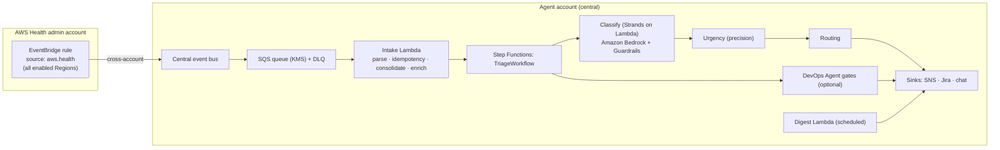

<!-- Copyright (c) 2026 Amazon Web Services -->
<!-- Licensed under the MIT-0 License -->
<!-- See LICENSE file in the project root for full license information. -->

# AWS Health Event Triage Agent

> **This is sample code, for non-production usage.** You should work with your security and
> legal teams to meet your organizational security, regulatory and compliance requirements
> before deployment.

An AI agent that triages [AWS Health](https://aws.amazon.com/health/) events across an
entire AWS Organization — classifying, enriching, routing, and escalating them so
operations teams respond faster and with more context than the AWS Health Dashboard
alone provides.

Licensed under the [MIT-0 License](LICENSE).

---

## What it does

AWS Health sends events for every account in your organization: scheduled maintenance,
security bulletins, service issues, deprecations, quota changes. At any real scale, that
feed is too much for a human to triage event-by-event — this agent does it for you:

1. **Ingests** every AWS Health event across your organization into one place, deduplicated.
2. **Classifies** each event's urgency and category with an AI agent (Amazon Bedrock +
   Guardrails), backed by deterministic code for anything that needs to be exact — counting,
   scoring, cost math.
3. **Enriches** the ~25% of events that need deeper investigation (what's actually
   affected, is a deadline-bound change safe to make) by dispatching an
   [AWS DevOps Agent](https://aws.amazon.com/devops-agent/) investigation — no per-service
   plug-in code to write or maintain as AWS adds new event types.
4. **Routes** each event to the right destination — Slack, Microsoft Teams, Jira, or a
   plain SNS topic — based on your own routing rules.
5. **Digests** advisory/maintenance-class events into a scheduled summary instead of
   individual noise.

The agent is **read-only against your AWS accounts by default** — see
[MUTATING_ACTIONS.md](MUTATING_ACTIONS.md).

### Design principle

Deterministic code decides *whether*, *when*, and *where* — classification, urgency
scoring, routing rules, deadlines, cost projection. An AWS DevOps Agent investigation
decides *what's actually affected* and *what to do about it*, only for the events that
need that depth. This split is why adding a new AWS service to the Health feed needs a
skill-wording change, not new plug-in code — see
[docs/ARCHITECTURE.md](docs/ARCHITECTURE.md) for the full design rationale and build
history.



---

## Quick start

**→ [QUICKSTART.md](QUICKSTART.md) has the full, step-by-step guide** (prerequisites,
CDK bootstrap, deployment, configuration, troubleshooting). The summary:

```bash
git clone https://github.com/aws-samples/aws-health-event-triage-agent.git
cd aws-health-event-triage-agent
python3 -m venv .venv && source .venv/bin/activate
pip install -r requirements.txt
pytest tests/ -q                        # sanity check — all tests run offline, no AWS calls

cd infra && npm install
cdk bootstrap aws://<account-id>/<region>   # first time only, per account+region
cdk deploy --all
```

That deploys the complete system for a **single account**: all 6 stacks — ingestion,
classification, urgency scoring, routing/sinks, scheduled digest, and the AWS DevOps
Agent enrichment infrastructure (the investigation gate itself is off by default until
you populate an `AgentSpaceRegistry` — see [QUICKSTART.md](QUICKSTART.md)). **Org-wide
ingestion across your AWS Organization** is an additional, optional step — granting the
Health admin account permission on the central bus, then deploying
`infra/stacksets/health-forwarding.yaml` as a CloudFormation StackSet to every Region you
have Health events enabled in (`us-east-1` is mandatory regardless of your other Regions)
— see [QUICKSTART.md Step 7](QUICKSTART.md#step-7--org-wide-ingestion-across-your-aws-organization-optional)
for the full, verified procedure.

### Prerequisites

- Python 3.12+
- Node.js 20+ and AWS CDK v2
- Docker (daemon running) — required at deploy time for Python Lambda bundling
- An AWS account with permissions to deploy CloudFormation, and (for the full org-wide
  deployment) delegated-admin access to AWS Organizations

---

## Configuration

All configuration is environment variables, read once in `src/config.py`. Nothing is
hardcoded in application code.

**The table below describes `src/config.py`'s inputs for local/CLI use — it does not
describe the deployed system.** The Lambda functions Step Functions invokes get
`SNS_TOPIC_ARN`, `KMS_KEY_ARN`, and every table/secret name wired onto their environment
automatically by CDK at deploy time; you never set these for the deployed pipeline to
work. They only matter if you run `src/` code directly (a script, a REPL, local testing)
outside the deployed Lambdas — see [QUICKSTART.md](QUICKSTART.md) Step 5 for how to load
them into your shell (`.env` is not loaded automatically; it must be `source`d).

| Variable | Required | Default | Description |
|----------|----------|---------|-------------|
| `BEDROCK_MODEL_ID` | No | `eu.anthropic.claude-sonnet-5` | Amazon Bedrock model ID used for classification |
| `BEDROCK_REGION` | No | `eu-west-1` | AWS Region for Amazon Bedrock calls |
| `AWS_REGION` | No | `eu-west-1` | General-purpose AWS Region |
| `SNS_TOPIC_ARN` | Yes (prod) | — | SNS topic for classification results |
| `GUARDRAIL_ID` | Yes (prod) | — | Amazon Bedrock Guardrail ID |
| `GUARDRAIL_VERSION` | No | `DRAFT` | Guardrail version |
| `SYSTEM_PROMPT_S3_BUCKET` | No | — | S3 bucket for an externalized system prompt override |
| `SESSION_TABLE_NAME` | No | `health-triage-sessions` | DynamoDB session table |
| `APP_CONTEXT_TABLE_NAME` | No | — | DynamoDB table for application trust-store data |
| `EKS_MCP_ENABLED` | No | `false` | Enable the local EKS MCP server |
| `KMS_KEY_ARN` | No | — | Customer-managed KMS key ARN |

---

## Security

- **Read-only by default.** This agent's IAM role has no write permission against your
  AWS accounts. See [MUTATING_ACTIONS.md](MUTATING_ACTIONS.md) for what that means and
  how to opt into write actions after review.
- **Guardrails.** Every Amazon Bedrock call runs through an Amazon Bedrock Guardrail
  (content filters, PII handling, denied topics).
- A full [SECURITY.md](SECURITY.md) (STRIDE threat model, data classification, key
  management) documents this agent's security posture, including the controls that are
  **not** implemented in this sample (e.g. no automated secret rotation, no VPC, no
  IAM permission boundary) alongside the ones that are.
- Found a security issue? Please report it privately — see
  [CONTRIBUTING.md](CONTRIBUTING.md#security-issue-notifications). Do not open a public
  GitHub issue for a security vulnerability.

---

## Learn more

| Document | What's in it |
|---|---|
| [QUICKSTART.md](QUICKSTART.md) | Full setup guide: prerequisites, deployment, configuration, troubleshooting |
| [docs/ARCHITECTURE.md](docs/ARCHITECTURE.md) | System design, the DevOps Agent enrichment approach, phase-by-phase build history |
| [MUTATING_ACTIONS.md](MUTATING_ACTIONS.md) | Why this agent is read-only by default, and how to enable write actions |
| [.kiro/specs/aws-health-event-triage-agent/requirements.md](.kiro/specs/aws-health-event-triage-agent/requirements.md) | The full requirement set this build satisfies |

---

## Contributing

See [CONTRIBUTING.md](CONTRIBUTING.md) for contribution guidelines and
[CODE_OF_CONDUCT.md](CODE_OF_CONDUCT.md) for the project's code of conduct.
