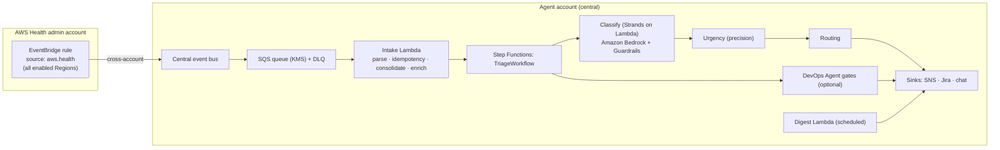

<!-- Copyright (c) 2026 Amazon Web Services -->
<!-- Licensed under the MIT-0 License -->
<!-- See LICENSE file in the project root for full license information. -->

# Architecture

This document is for readers extending or deeply customizing this fork: how the system
is built and why it's built that way. If you just want to run it, see the main
[README.md](../README.md) instead.

---

## System diagram



The classification step uses a Strands Agent (pattern #6: Strands on Lambda) with one
Amazon Bedrock call per event plus at most three read-only tool calls. Everything else —
deduplication, urgency scoring, routing, cost projection, ticket management — is
deterministic Python code (see the tool-classification table in
[requirements.md](../.kiro/specs/aws-health-event-triage-agent/requirements.md) for which
tools are data-retrieval vs. precision).

**Design principle: code decides whether, when, and where; AWS DevOps Agent finds out what
is affected and what to do.** Deadline-class impact enrichment and readiness assessment run
as AWS DevOps Agent investigations through a gated webhook mechanism, not a per-service
Lambda plug-in. Each new AWS service appearing in the Health feed needs a skill-wording
change, not new plug-in code, a new IAM permission, or a StackSet update — see "Enrichment"
below for how this works, and
[the master spec's design.md](../.kiro/specs/aws-health-event-triage-agent/design.md) §13's
decision record for why a custom agent was rejected for this role instead.

---

## Enrichment: code decides, DevOps Agent investigates

For deadline-class events, a single AWS DevOps Agent investigation answers both "what is
affected" and "is this change safe to make" — requested through a signed webhook,
`.waitForTaskToken`, and an `aws.aidevops` EventBridge callback. The investigation is
tagged as an enrichment request; the same mechanism also supports plain incident-gate
requests (R12.2) when the DevOps Agent gate module is enabled.

**Coverage is "anything DevOps Agent can describe."** There is no per-service Lambda
plug-in to write or maintain as AWS adds new event types to the Health feed — the entity
list AWS already sends is primary evidence, qualified by the event type's **impact
locus**: for a `listed_resource` event (e.g. a Lambda runtime deprecation) the listed
entity *is* the thing that breaks, so entity presence alone is `confirmed`; for a
`dependent` event (e.g. a certificate-authority rotation) the listed entity is merely *in
scope*, pending something AWS cannot see (a client's trust store, an SDK version) — this
is `in_scope_unverified`, never `confirmed` on entity presence alone. An investigation can
only ever add depth to the first case; it can *change* the status for the second, if it
actually verifies the dependents.

**What a customer forking this should know:**

- **One member-account role.** The Inventory Lambda makes no AWS API call at all under
  this design — the DevOps Agent secondary role (which any account associated with an
  Agent Space already needs, regardless of this solution) is the only role a new
  deployment needs.
- **Enrichment takes minutes, not seconds**, for the subset of events that need it.
  Against typical 90-day deadline horizons this is a deliberate trade-off, not a
  regression against the latency target that governs disposition and ticket creation
  (which does not wait on enrichment depth).
- Readiness assessment (is this change safe to make before its deadline, and what blocks
  it) runs inside the **same** investigation as impact enrichment, via a `## Readiness`
  section on the same callback — not a second webhook round-trip.

**Deployment profile — the coverage rule.** The Agent Space association is the single
enrichment enablement switch; there is no fallback role. Choose knowingly between two
profiles:

| Profile | What it means | What you get |
|---|---|---|
| **Associate every account** (recommended) | Every account whose Health events you want enriched is a secondary association of a registered Agent Space — one `DEFAULT` space is enough for a single-team deployment; a federated organization associates each business unit's accounts with its own space. | Full enrichment (and the incident gate) for every account, exactly as this reference deployment ships. |
| **Federated, partial association** | Only some business units have associated their accounts with a space. | Associated accounts get full enrichment. Un-associated accounts still get a ticket with `impact: confirmed` (for `listed_resource` events) from the entity list alone, but lose readiness state and cost projection. A `dependent`-locus account is unaffected either way, since client trust stores are never verified without an investigation. |

**Agent Space co-location.** This reference deployment recommends, and its CDK implements,
every Agent Space in the operations tooling account (the account running this stack)
rather than in an owner account elsewhere. This keeps `aws.aidevops` investigation-completion
events same-account, so the central bus's own callback rule receives them directly — no
forwarding StackSet is needed. If your organization must keep an Agent Space in a different
account for data-segregation or compliance reasons, add a forwarding rule for that owner
account yourself; the callback handler is unchanged either way.

**Rollback lever.** The `-c enrichmentViaDevOpsAgent=true|false` CDK context flag (default
`true` — this is the intended architecture, not an opt-in) decides whether a deployed stack
routes deadline-class events through the DevOps Agent investigation path or a
no-investigation baseline (entity-list-only status, no service-specific enrichment, no cost
projection).

---

## Deployment topology

`infra/bin/app.ts` instantiates six CDK stacks — `CoreStack`, `GuardrailStack`,
`DevOpsAgentStack`, `TriageWorkflowStack` (which builds its own Python Lambda functions via
`PythonFunction`/Docker bundling — see the inline comments at the top of
`infra/lib/triage-workflow.ts` for why they're built inside this stack
rather than passed in), `HealthTriageLeafFunctionsStack` (intake + digest functions), and
`HealthTriageDigestStack` (the scheduler). Verified via `cdk synth` (requires Docker for
the Python dependency bundling).

Three CDK context flags control deployment shape:

| Flag | Default | Effect |
|---|---|---|
| `-c deployEnvironment=production\|prototype` | `prototype` | Controls log retention |
| `-c enableDevOpsAgentGate=true` | off | Builds the DevOps Agent Lambdas and the EventBridge callback rule. Off by default — the module needs a populated `AgentSpaceRegistry` first |
| `-c enrichmentViaDevOpsAgent=true\|false` | `true` | Routes deadline-class events through the enrichment investigation path (`true`) or the entity-list-only rollback baseline (`false`). No effect when `enableDevOpsAgentGate` is `false` |

---

## Project layout

```
src/                              # Agent source (Python 3.12+)
├── config.py                     # Centralised env-var configuration (only os.environ reader)
├── schemas/                      # JSON schemas: health_event_v1, notification_payload_v1, classification_result_v1
├── intake/                       # EventBridge intake, idempotency, account context, event parsing
├── classifier/                   # Strands-on-Lambda classifier + worker_handler.py (workflow steps)
├── triage/                       # Urgency, disposition, routing (resolve_team), lifecycle (should_close)
├── inventory/                    # build_impact_inventory + INVENTORY_BASELINE/PROJECT_COST/MERGE_ENRICHMENT steps (handler.py)
├── cost/                         # Price List API cost projection (precision)
├── digest/                       # Scheduled digest Lambda
├── sinks/                        # SnsSink (core) · JiraSink · SlackSink · TeamsSink · dispatcher
├── devops_agent/                 # DevOps Agent gate, registry, trigger, outcome, dedupe, counters,
│                                  #   workflow_handler (Step Functions steps), callback_handler
│                                  #   (aws.aidevops EventBridge handler), readiness gate/tracker,
│                                  #   affected_resources.py (contract parser),
│                                  #   resolve_agent_spaces_by_account (per-account distinct-space grouping)
├── reconcile/                    # Optional watermark-based reconciliation
├── tools/                        # get_event_type_guidance, get_affected_entities, normalize_dates
└── prompts/classifier.md         # Externalized classifier system prompt

tests/                            # Unit and integration tests (pytest + hypothesis property tests)
├── unit/                         # One subdirectory per src/ package above
└── integration/                  # Cross-component and workflow-level tests

infra/                            # CDK v2 TypeScript infrastructure
├── bin/app.ts                    # CDK app entry point (CoreStack, GuardrailStack, DevOpsAgentStack)
├── lib/
│   ├── core-stack.ts             # KMS · DynamoDB · SQS+DLQ · SNS · logs · alarms · sink secrets
│   ├── guardrail-stack.ts        # Amazon Bedrock Guardrail
│   ├── triage-workflow.ts        # TriageWorkflow Step Functions definition
│   ├── digest-stack.ts           # Digest scheduler
│   ├── devops-agent-stack.ts     # TaskTokenTable, AgentSpaceCounters, ActiveInvestigations,
│                                  #   ReadinessAssessmentsTable, DevOpsAgentSpace
│   └── constructs/
│       └── devops-agent-space.ts # AgentSpaceRole, OperatorRole, AgentSpace, Association, webhook custom resource
├── lambda/
│   └── devops-agent-webhook-provisioner/  # RegisterService/AssociateService/PutSecretValue custom resource
└── stacksets/                    # StackSet A (Health intake) — the only StackSet this repository ships or needs

devops-agent-skill/SKILL.md       # The AWS DevOps Agent investigation methodology this agent ships
devops-agent-skill/readiness-assessment/SKILL.md  # The readiness-assessment methodology
config/                           # Runtime configuration seeds (routing.example.json, agent_space_registry.example.json)
eval/                             # Evaluation report
```

---

## Further reading

- [Master spec: requirements.md](../.kiro/specs/aws-health-event-triage-agent/requirements.md) — the full requirement set (R1–R13) this build satisfies
- [Master spec: design.md](../.kiro/specs/aws-health-event-triage-agent/design.md) — architecture and tool design decisions in depth
- [MUTATING_ACTIONS.md](../MUTATING_ACTIONS.md) — why this agent is read-only by default, and what a customer must opt into for write actions
